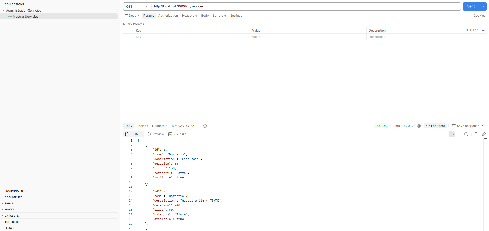
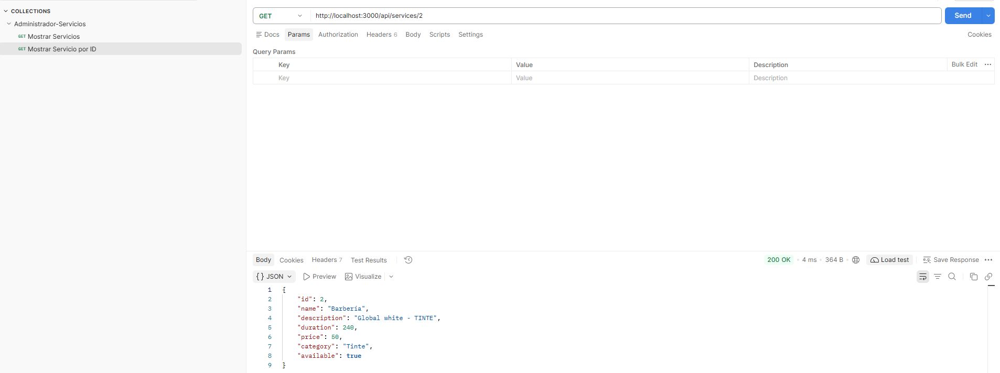
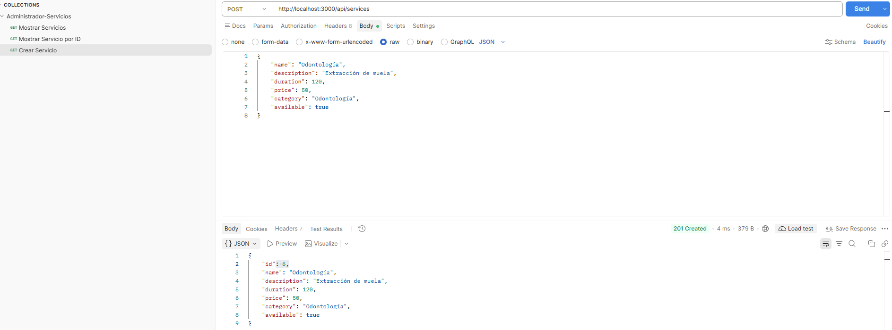
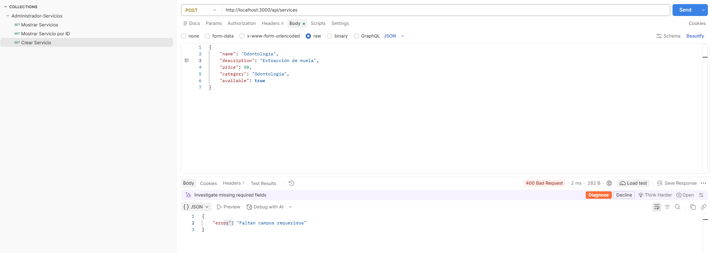
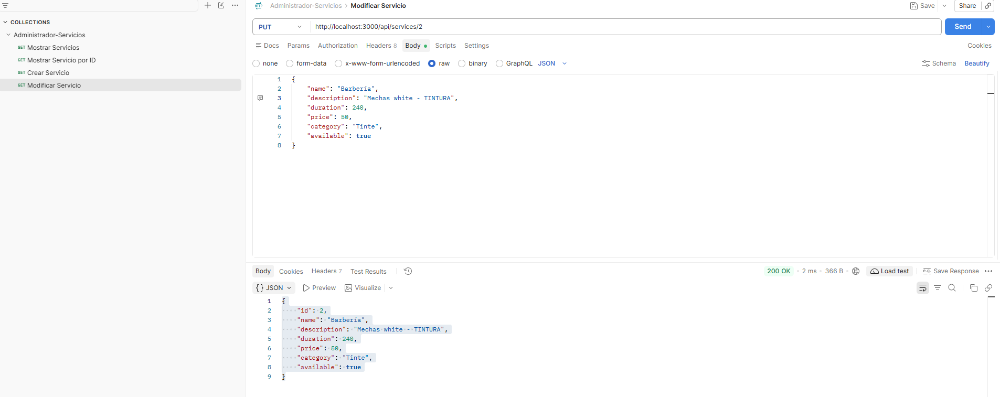
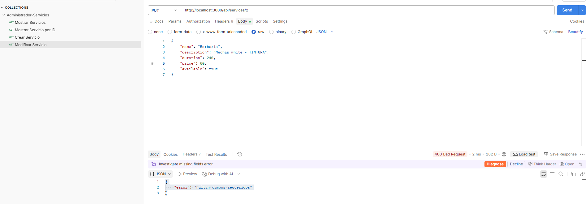
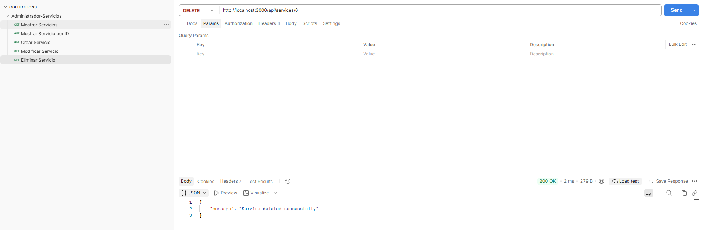
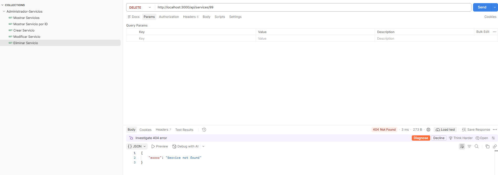

# Administrador de Servicios

## Descripción

Proyecto desarrollado con Node.js, Express y ECMAScript Modules (ESM) que implementa una API REST para gestionar los servicios de un sistema de turnos y reservas.

La aplicación utiliza una clase `ServiceManager` para centralizar la logica de gestión de servicios y un sistema de almacenamiento basado en archivos JSON.

Permite consultar, agregar, actualizar y eliminar servicios mediante enpoints HTTP.

## Tecnologías utilizadas

- Node.js
- JavaScript (ESM)
- dotenv
- File System (fs)
- JSON
- Express
- POSTMAN

## Estructura del proyecto


Administrador-Servicios/
├── src/
│   ├── config/
│   │   └── env.config.js
│   ├── data/
│   │   └── services.json
│   ├── managers/
│   │   └── ServiceManager.js
│   ├── routes/
│   │   └── services.router.js
│   ├── app.js
│   └── server.js
├── docs/
│   └── postman/
├── .env
├── .env.example
├── .gitignore
├── package.json
├── package-lock.json
└── README.md


## Instalación

1. Clonar el repositorio:

```bash
git clone URL_DEL_REPOSITORIO
```

2. Ingresar al directorio del proyecto:

```bash
cd administrador-servicios
```

3. Instalar las dependencias:

```bash
npm install
```

4. Crear un archivo `.env` en la raíz del proyecto con las siguientes variables:

```env
PORT=8080
NODE_ENV=development
```

## Ejecución

Para ejecutar el proyecto:

```bash
node src/server.js
```

La configuración del entorno se valida al iniciar la aplicación. Si falta alguna variable requerida, se genera un error indicando cuál debe configurarse.

## Variables de entorno

| Variable | Descripción | Valor de ejemplo |
|---|---|---|
| PORT | Puerto de la aplicación | 8080 |
| NODE_ENV | Entorno de ejecución | development |

## Recurso: Services

Cada servicio contiene las siguientes propiedades:

| Propiedad | Descripción |
|---|---|
| id | Identificador único generado automáticamente |
| name | Nombre del servicio |
| description | Descripción del servicio |
| duration | Duración del servicio |
| price | Precio del servicio |
| category | Categoría del servicio |
| available | Disponibilidad del servicio |

## Métodos de ServiceManager

### getServices()

Devuelve todos los servicios registrados.

```javascript
serviceManager.getServices();
```

### getServiceById(id)

Busca y devuelve un servicio según su identificador. Si no existe, devuelve `null`.

```javascript
serviceManager.getServiceById(1);
```

### addService(serviceData)

Agrega un nuevo servicio. El identificador se genera automáticamente y se valida que estén presentes todos los campos obligatorios.

```javascript
serviceManager.addService({
    name: "Odontología",
    description: "Extracción de muela",
    duration: 30,
    price: 100,
    category: "Dental",
    available: true
});
```

### updateService(id, updatedData)

Actualiza los datos de un servicio existente sin permitir modificar su identificador. Si no existe, devuelve `null`.

```javascript
serviceManager.updateService(1, {
    price: 150
});
```

### deleteService(id)

Elimina un servicio según su identificador. Si no existe, devuelve `null`.

```javascript
serviceManager.deleteService(1);
```

## API REST - Services

La API permite gestionar el recurso `services` mediante los siguientes endpoints.

**URL base:**

```text
http://localhost:8080/api/services
```

### Endpoints disponibles

| Método | Endpoint | Descripción |
|---|---|---|
| GET | `/api/services` | Obtiene todos los servicios |
| GET | `/api/services/:sid` | Obtiene un servicio por ID |
| POST | `/api/services` | Crea un nuevo servicio |
| PUT | `/api/services/:sid` | Actualiza un servicio |
| DELETE | `/api/services/:sid` | Elimina un servicio |

### 1. GET - Obtener todos los servicios

```http
GET /api/services
```

Devuelve el listado completo de servicios registrados.

También permite aplicar filtros mediante query params:

```http
GET /api/services?category=salud
```

```http
GET /api/services?available=true
```

**Captura de Postman:**



### 2. GET - Obtener un servicio por ID

```http
GET /api/services/:sid
```

Busca un servicio utilizando su identificador.

- `200 OK`: servicio encontrado.
- `404 Not Found`: servicio inexistente.

**Captura de Postman:**



### 3. POST - Crear un servicio

```http
POST /api/services
```

Permite registrar un nuevo servicio mediante el body de la petición en formato JSON.

Ejemplo:

```json
{
  "name": "Odontología",
  "description": "Extracción de muela",
  "duration": 30,
  "price": 100,
  "category": "salud",
  "available": true
}
```

El identificador se genera automáticamente desde `ServiceManager`, por lo que no debe enviarse en el body.

- `201 Created`: servicio creado correctamente.
- `400 Bad Request`: faltan campos obligatorios.

**Captura de Postman:**




### 4. PUT - Actualizar un servicio

```http
PUT /api/services/:sid
```

Permite actualizar los datos de un servicio existente mediante el body de la petición.

Ejemplo:

```json
{
  "price": 150
}
```

El identificador no puede modificarse.

- `200 OK`: servicio actualizado correctamente.
- `404 Not Found`: servicio inexistente.

**Captura de Postman:**




### 5. DELETE - Eliminar un servicio

```http
DELETE /api/services/:sid
```

Elimina un servicio utilizando su identificador.

- `200 OK`: servicio eliminado correctamente.
- `404 Not Found`: servicio inexistente.

**Captura de Postman:**




## Recurso: Services

Cada servicio contiene las siguientes propiedades:

| Propiedad | Descripción |
|---|---|
| id | Identificador único generado automáticamente |
| name | Nombre del servicio |
| description | Descripción del servicio |
| duration | Duración del servicio |
| price | Precio del servicio |
| category | Categoría del servicio |
| available | Disponibilidad del servicio |

## Arquitectura y responsabilidades

El proyecto separa las responsabilidades en diferentes módulos:

- **env.config.js:** carga y valida las variables de entorno.
- **ServiceManager.js:** centraliza la lógica CRUD y el acceso al almacenamiento JSON.
- **services.router.js:** define los endpoints y conecta las peticiones HTTP con `ServiceManager`.
- **app.js:** configura Express y registra las rutas.
- **server.js:** inicia el servidor utilizando la configuración del entorno.

## Almacenamiento de datos

Los servicios se almacenan en `src/data/services.json`.

La clase `ServiceManager` utiliza el módulo `fs` de Node.js para leer y escribir los datos, manteniendo los cambios realizados en el archivo JSON.

## Proyecto


**Proyecto realizado como parte de la formación en Backend con Node.js.**